<div align="center">


# Cairn

**One step at a time.** A calm, local-first task planner for brains that get overwhelmed by long lists.

[](https://github.com/rmaytr/TasksApp/actions/workflows/ci.yml)
[](https://github.com/rmaytr/TasksApp/actions/workflows/deploy.yml)


[](LICENSE)

**[Open the app →](https://rmaytr.github.io/TasksApp/)** · free · no sign-up · works offline

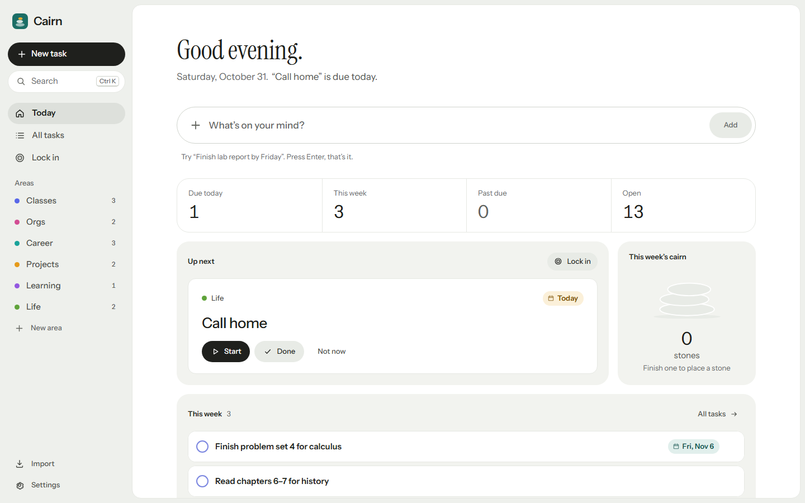

</div>

> A *cairn* is the small stack of stones hikers leave to mark a trail. You never need to see the whole
> path, only the next stone.

---

## Contents

- [Why Cairn](#why-cairn)
- [Features](#features)
- [How it works](#how-it-works)
- [Tech stack](#tech-stack)
- [Project in numbers](#project-in-numbers)
- [Getting started](#getting-started)
- [Testing](#testing)
- [Privacy and security](#privacy-and-security)
- [Project structure](#project-structure)
- [Documentation](#documentation)
- [Roadmap](#roadmap)
- [License](#license)

---

## Why Cairn

Most to-do apps assume you already plan well. For students and anyone with ADHD, they become a guilt
pile: one long column, red overdue badges, a dozen fields per task, and no answer to the only
question that matters in the moment, *what do I do right now?*

Cairn is built on three rules:

| Rule | What it means in the app |
| --- | --- |
| **Capture costs one keystroke** | One text box. Area, date and priority are read from your words (`Finish lab report by Friday !`) and shown as a quiet preview you can fix but never have to. |
| **Show one thing, not everything** | Today leads with a single **Up next** card and a short list. Everything else is one click away. |
| **When it's too much, let the tool decide** | **Lock in** picks one task, shows only its next small step and says why it comes first. Every finished step stacks a stone on your cairn. |

Behaviour-science ideas behind the design are summarised in
[docs/DESIGN.md](docs/DESIGN.md#research-behind-the-design).

---

## Features

### Today, the home screen

A greeting set in a serif face and, under it, the one fact that matters today, written from your data
("*Calculus problem set* is due on Fri, Oct 23."). Below it:
- a capture box;
- counts for what's due today, this week, past due and open;
- **Up next** (Start · Done · Not now);
- **This week's cairn**, one stone for every task you finished this week.

<table>
<tr>
<td width="50%">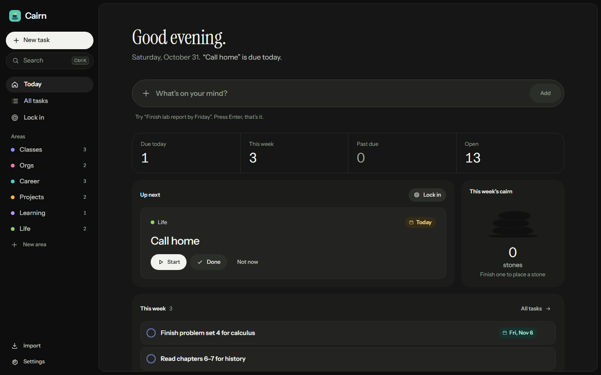</td>
<td width="50%">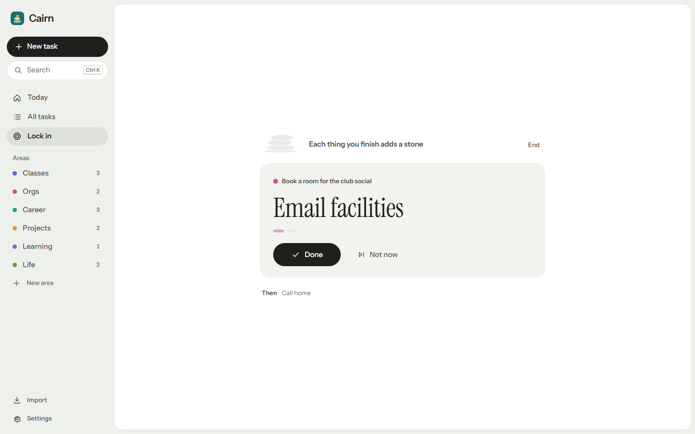</td>
</tr>
<tr>
<td align="center"><sub>Dark mode</sub></td>
<td align="center"><sub>Lock in: one task, one step</sub></td>
</tr>
</table>

### Capture in plain words

| You type | Cairn files it as |
| --- | --- |
| `Finish lab report by Friday !` | *Classes* · due Fri · high priority |
| `Call home this weekend` | *Life* · due Saturday |
| `Email mentee #orgs tomorrow` | *Orgs* · due tomorrow |
| `Read chapter 4 @someday ~s` | *Classes* · Someday · small |

- **Dates:** `today`, `tomorrow`, weekdays, `this weekend`, `next weekend`, `next week`, `eow`,
  `eod`, `nov 3`, `11/3`, `in 3 days`, `in 2 weeks`.
- **Areas:** `#area`, or guessed from the words.
- **Priority** `!`, **size** `~s ~m ~l`, **horizon** `@today @week @month @later @someday`.

### Plan with less effort

- **Dependency-aware order.** A task can *start after* another. The planner sorts by deadline,
  priority, size and what's blocking what, and never lets a loop form.
- **Dates you can read.** Every date shows its weekday and day ("Fri, Oct 23"), coloured by how
  close it is. A calendar with quick picks sets it.
- **Snooze.** One day later, or one step out (Today → This week → …) for undated tasks.
- **Sort** by smart order, due date or priority; reverse it; search titles, notes and steps.
- **Repeating tasks**, **steps** inside tasks, and a three-minute **weekly reset**.
- **Reminders** the evening before and the morning of a deadline (system notifications where allowed).

### Quick actions where things are

<table>
<tr>
<td width="50%">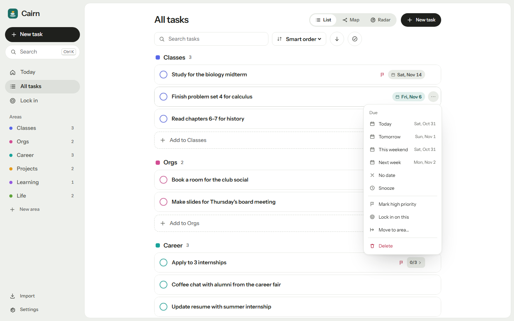</td>
<td width="50%">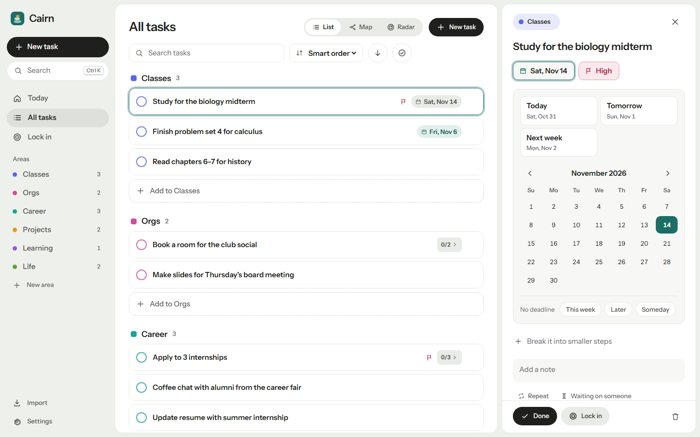</td>
</tr>
<tr>
<td align="center"><sub>The ⋯ menu on every task (or right-click)</sub></td>
<td align="center"><sub>The task panel and calendar</sub></td>
</tr>
</table>

- **Areas:** the ⋯ next to an area (or right-click) adds a task there, renames it in place,
  recolours, reorders or deletes it.
- **Drag** a task onto an area or onto *Today* in the sidebar to move it.
- **On a phone, swipe** a task right to finish it or left to snooze it.
- **Undo** for everything destructive.

### Three ways to see it all

<table>
<tr>
<td width="50%">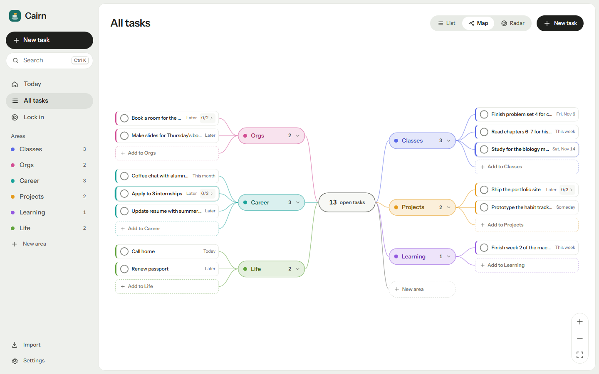</td>
<td width="50%">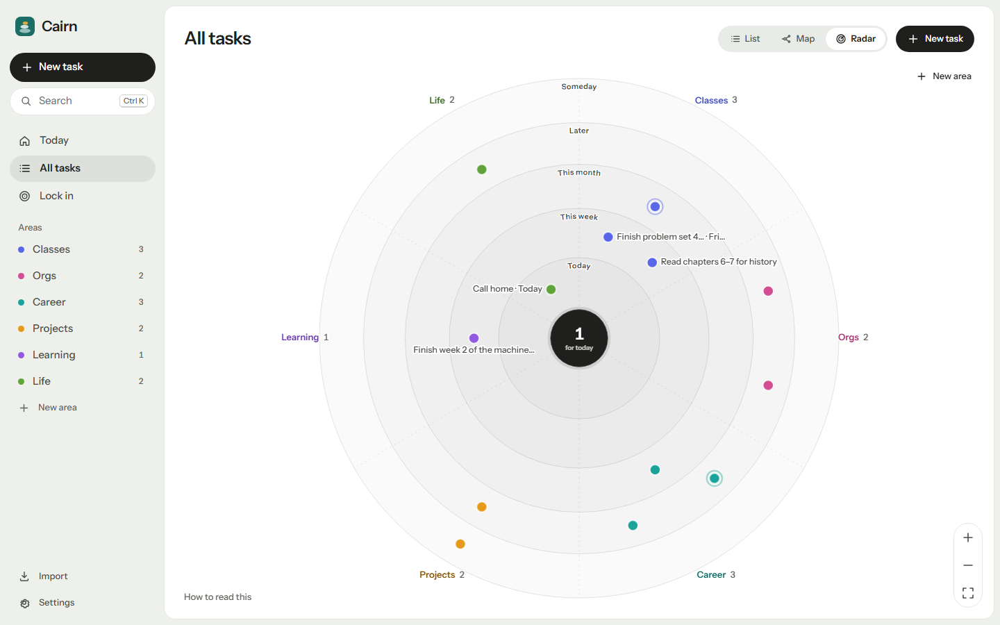</td>
</tr>
<tr>
<td align="center"><sub>Map: a mind map of areas and tasks</sub></td>
<td align="center"><sub>Radar: nearer the middle means sooner</sub></td>
</tr>
</table>

Plus a plain **List**, grouped by area (or by when, on an area's page).

### On your phone

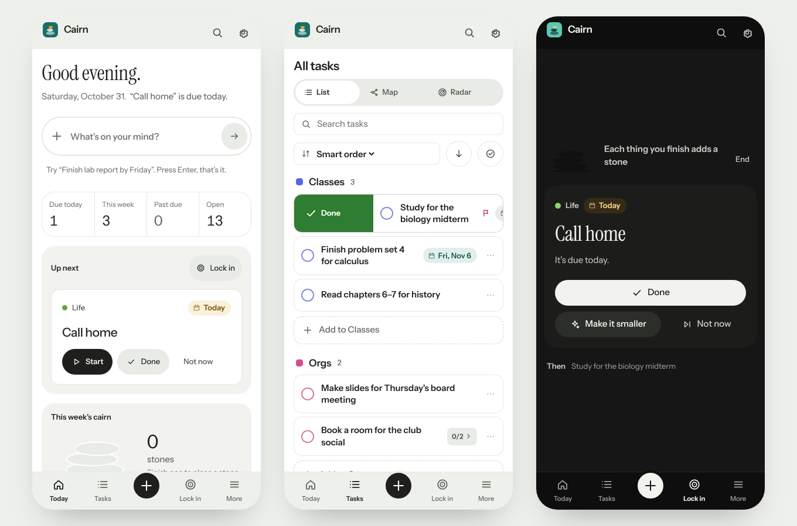

### The assistant (optional)

Turn it on in **Settings → Assistant** with your own Anthropic key (or an invite code if the operator
runs the [proxy](worker/README.md)) and describe a task in plain words:

> Publish the domain for the BOR Realty site this weekend and add it to my portfolio and resume

Claude turns it into one task with steps in the order they have to happen. It picks the area, reads
"this weekend" as Saturday and sets the priority. Related tasks you already have (like *Update resume*)
are marked to start after it. In **Lock in**, Claude orders everything open, explains the first pick,
and **Make it smaller** breaks a stuck task into steps.

It's off by default. Only the new task's text plus the titles, areas, due dates and priorities of open
tasks are sent; notes and steps never leave your device.

### Also

Import from plain text, Markdown checklists (including Obsidian Tasks dates), JSON or Todoist CSV, and
back up to JSON or Markdown. Light and dark themes, keyboard shortcuts, installable, fully offline.

| Key | Action |
| --- | --- |
| `/` or `n` | Add a task |
| `Ctrl K` | Find any task |
| `1` `2` `3` | Today, All tasks, Lock in |
| `i` | Import |
| `z` | Undo |
| `Esc` | Close the open task, menu or dialog |
| `?` | Settings and shortcuts |

---

## How it works

Cairn is a **local-first** single-page app. Everything you create lives in your browser's IndexedDB,
and the network is only used when you opt in to sync or the assistant.

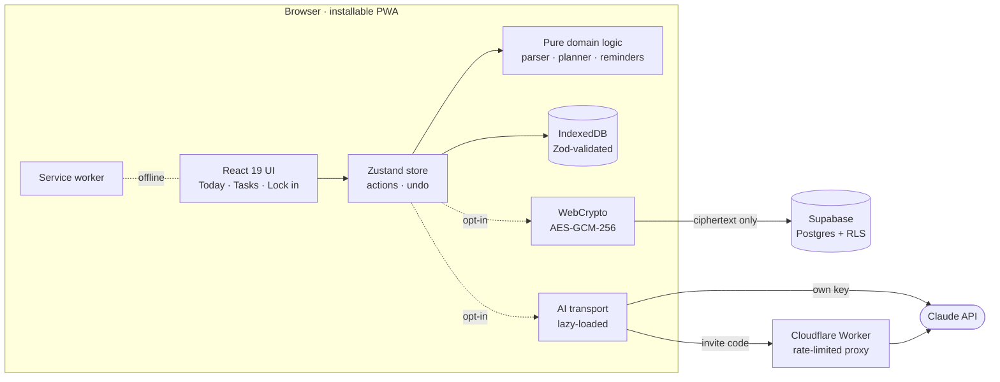

### From a sentence to a task

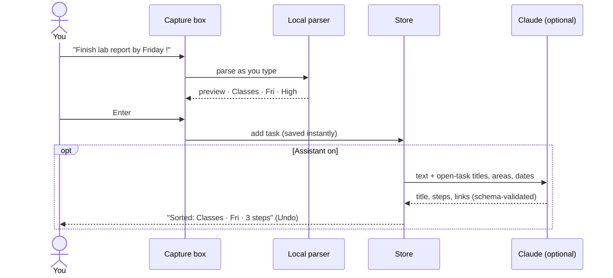

### Lock in

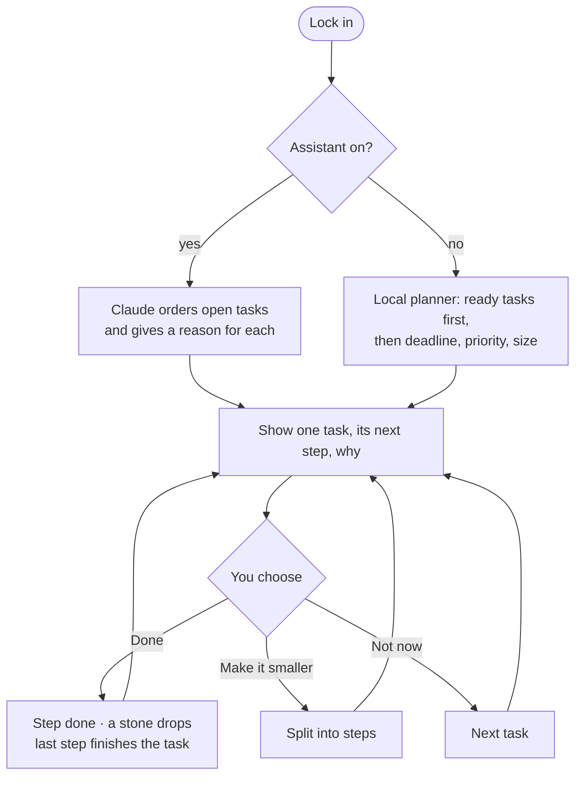

More diagrams (data model, planner, reminders, sync) are in
[docs/ARCHITECTURE.md](docs/ARCHITECTURE.md).

---

## Tech stack

| Layer | Technology |
| --- | --- |
| Language | **TypeScript 6** (strict) |
| UI | **React 19**, hand-written CSS with design tokens, **Motion** for springs and gestures |
| State and storage | **Zustand 5** persisted to **IndexedDB** (idb-keyval), **Zod 4** schemas everywhere data crosses a boundary |
| Build and PWA | **Vite 8**, **vite-plugin-pwa** (Workbox), build-time Content Security Policy |
| AI (optional) | **Anthropic Claude API** (Claude Haiku 5.5, structured outputs, prompt caching) |
| Sync (optional) | **Supabase** Auth + Postgres with Row Level Security, **WebCrypto** end-to-end encryption |
| AI proxy (optional) | **Cloudflare Workers** + KV |
| Testing | **Vitest**, Testing Library, fake-indexeddb, **Playwright** |
| CI/CD | **GitHub Actions** → GitHub Pages |

---

## Project in numbers

| | |
| --- | --- |
| Application code | ~12,100 lines of TypeScript in 139 files |
| Styles | ~5,200 lines of hand-written CSS, light and dark themes |
| Automated tests | **846** unit and integration tests · **33** end-to-end tests |
| Runtime dependencies | 10 |
| AI cost per captured task | ≈ $0.001 (Claude Haiku 5.5) |

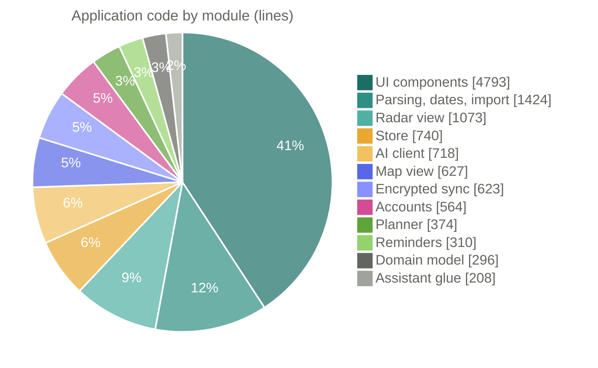

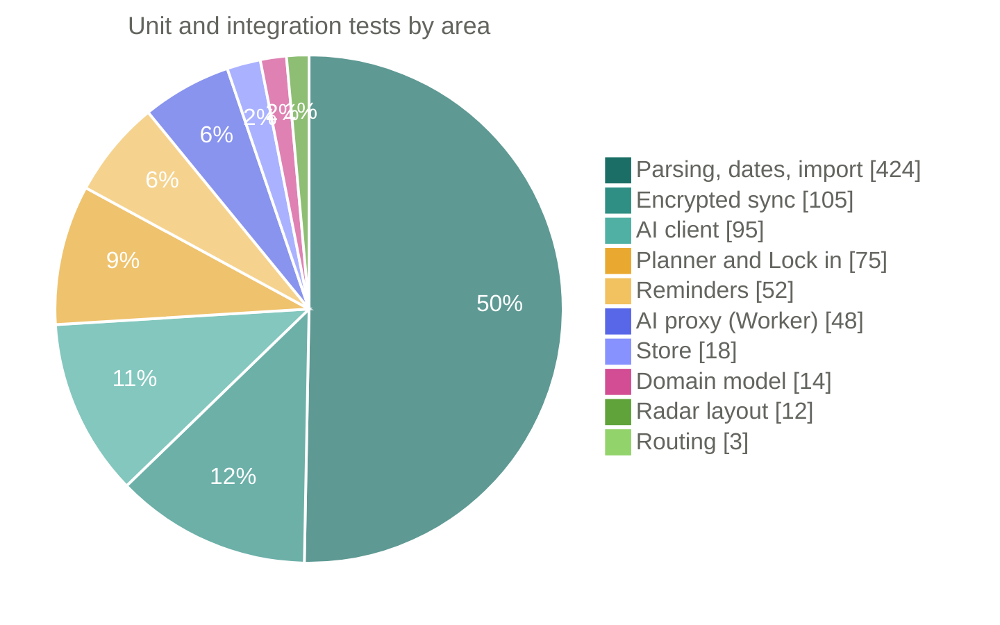

---

## Getting started

Requires **Node.js 20.19+** (22 recommended).

```bash
git clone https://github.com/rmaytr/TasksApp.git
cd TasksApp
npm install
npm run dev            # http://localhost:5173
```

Open `http://localhost:5173/?sample` in development to start with sample tasks.

| Script | What it does |
| --- | --- |
| `npm run dev` | Start the dev server |
| `npm run build` | Type-check and build to `dist/` |
| `npm run preview` | Serve the production build |
| `npm test` | Run the unit and integration tests |
| `npm run test:e2e` | Run the Playwright end-to-end tests |
| `npm run lint` | Lint with oxlint |
| `npm run typecheck` | Type-check only |

Everything works without configuration. To turn on sync or the shared assistant, see
[docs/DEPLOY.md](docs/DEPLOY.md). These are the optional environment variables:

| Variable | Enables |
| --- | --- |
| `VITE_SUPABASE_URL`, `VITE_SUPABASE_ANON_KEY` | Accounts and end-to-end encrypted sync |
| `VITE_AI_PROXY_URL` | Invite-code access to the assistant (`/api` on Vercel, or the Worker's URL) |
| `VITE_BASE` | Base path when hosted under a sub-folder (GitHub Pages uses `/TasksApp/`) |

---

## Testing

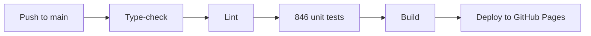

- **Unit and integration (Vitest):**
  - date and capture parsing, including DST and weekend edge cases;
  - all five importers;
  - planner order and cycle safety;
  - reminders, snooze and Lock in;
  - store actions and undo;
  - sync merge and encryption (tampering, wrong owner, rollback);
  - AI schemas and transports;
  - the Worker's routing, CORS, rate limits and brute-force throttle.
- **End-to-end (Playwright):**
  - onboarding, capture and area pages;
  - menus, drag and drop, and phone swipes;
  - export → import round trip;
  - offline reload;
  - layouts on a 375 px phone with no sideways scrolling.

---

## Privacy and security

- **Local-first:** no account, no analytics, no cookies. Without sync or the assistant, the app makes
  no network requests besides loading itself.
- **End-to-end encrypted sync:**
  - **PBKDF2-SHA-256** (600,000 iterations) derives an **AES-GCM-256** key from your passphrase;
  - each ciphertext is bound to its owner and version, and devices refuse rollbacks;
  - the server stores ciphertext only, behind Postgres Row Level Security.
- **The assistant:**
  - opt-in;
  - sends the minimum (no notes or steps);
  - treats model output as untrusted (schema-checked, clipped, no loops);
  - the shared proxy enforces an origin allowlist, invite codes, rate limits and body caps.
- **Hardened build:** strict CSP and no `eval` or raw HTML injection; the build refuses to ship a
  secret key.

Details: [SECURITY.md](SECURITY.md) · [docs/SYNC.md](docs/SYNC.md) ·
[privacy policy](docs/PRIVACY.md).

---

## Project structure

```
TasksApp/
├── src/
│   ├── components/   React screens and UI (Today, Tasks, task panel, Lock in, menus, dialogs)
│   ├── lib/          Dates, capture parser, area guessing, importers, export
│   ├── plan/         Planner (urgency + topological order) and Lock-in plan
│   ├── reminders/    Deadline reminders and notification permission
│   ├── store/        Zustand store, schemas, persistence, migrations
│   ├── model/        Domain types, derived state, repeat and snooze rules
│   ├── ai/           Claude client, prompts, output schemas, transports
│   ├── assist/       Assistant settings and task enrichment
│   ├── sync/         Sync document, merge, encryption, engine
│   ├── cloud/        Supabase client, auth, key storage
│   ├── radar/        Radar view (SVG)
│   └── map/          Map view
├── api/              Vercel Functions: the assistant proxy on the app's own domain
├── worker/           Cloudflare Worker: rate-limited Claude proxy (same handler)
├── supabase/         Database migration (tables, RLS, triggers)
├── e2e/              Playwright end-to-end tests
├── public/           Icons, manifest assets, privacy page
└── docs/             Architecture, design, sync, deploy, privacy
```

---

## Documentation

| Document | What's inside |
| --- | --- |
| [docs/ARCHITECTURE.md](docs/ARCHITECTURE.md) | Modules, data model, planner, reminders, AI and sync flows, key decisions |
| [docs/DESIGN.md](docs/DESIGN.md) | Product principles, research, design system (colour, type, motion), accessibility |
| [docs/SYNC.md](docs/SYNC.md) | Accounts and end-to-end encrypted sync, threat model |
| [docs/DEPLOY.md](docs/DEPLOY.md) | Hosting, Supabase, the AI proxy, launch checklist |
| [docs/PRIVACY.md](docs/PRIVACY.md) | Privacy policy |
| [SECURITY.md](SECURITY.md) | Security design and how to report a problem |
| [worker/README.md](worker/README.md) | The AI proxy: deploy, limits, cost |
| [CONTRIBUTING.md](CONTRIBUTING.md) | Setup, conventions, checks before a pull request |
| [CHANGELOG.md](CHANGELOG.md) | What changed in each version |

---

## Roadmap

- [x] Local-first PWA with natural-language capture and five importers
- [x] Today screen, area pages, dependency-aware planner, reminders
- [x] Optional Claude assistant and Lock in
- [x] End-to-end encrypted sync (ready to enable)
- [x] Context menus, drag and drop, phone swipes
- [ ] Turn on sync and the shared assistant on its own origin
- [ ] Web Push reminders when the app is closed
- [ ] Start dates ("hide until"), calendar (.ics) import and export
- [ ] Shared areas for a club or study group

---

## License

[MIT](LICENSE) © 2026 Rodion
