# Architecture

Cairn is a static, **local-first** single-page app. Everything a person creates lives in their
browser's IndexedDB. The app is a folder of static files that a service worker caches, so it opens
offline and can be installed. Two optional services sit outside the browser:
- encrypted **sync** (Supabase);
- a rate-limited **AI proxy** (Cloudflare Worker).

Neither is needed to use the app.

- [System overview](#system-overview)
- [Layers and modules](#layers-and-modules)
- [Data model](#data-model)
- [State, persistence and undo](#state-persistence-and-undo)
- [Routing](#routing)
- [Capture and parsing](#capture-and-parsing)
- [The planner](#the-planner)
- [Lock in](#lock-in)
- [Reminders](#reminders)
- [The assistant](#the-assistant)
- [Encrypted sync](#encrypted-sync)
- [Build, test and deploy](#build-test-and-deploy)
- [Key decisions](#key-decisions)

---

## System overview

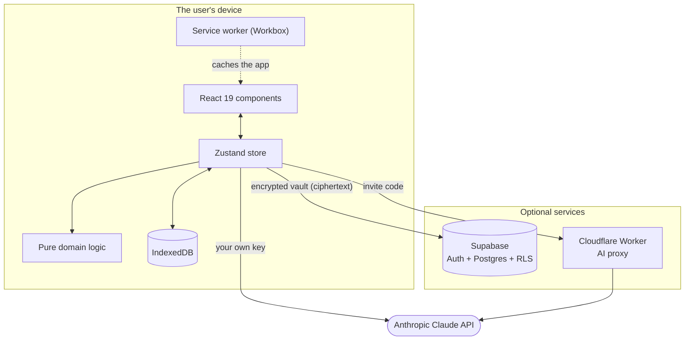

---

## Layers and modules

The code is split so that everything with real logic is **pure TypeScript with no React and no
store imports**. That keeps it fully unit-testable.

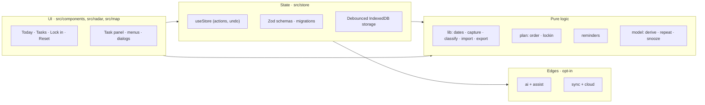

| Module | Responsibility |
| --- | --- |
| `src/components` | Screens and shared UI: Today, Tasks (list, sort, search), task panel, calendar, Lock in, the animated cairn, navigation, accessible menus, dialogs, settings, import |
| `src/radar`, `src/map` | The two visual views. Radar: polar layout with label collision avoidance, dragging between rings. Map: collapsible mind map, outline on phones |
| `src/store` | One Zustand store: tasks, areas, steps, preferences, navigation, undo snapshots, deletion tombstones. Schemas, migrations and the debounced IndexedDB adapter |
| `src/lib` | Date engine, capture parser, area guessing, five importers, Markdown/JSON export, link extraction |
| `src/plan` | Urgency scoring and dependency-aware ordering; the Lock-in plan |
| `src/reminders` | Which reminders are due now; delivery and permission hooks |
| `src/model` | Domain types, derived values (effective horizon, staleness), repeat and snooze rules |
| `src/ai`, `src/assist` | Runtime-agnostic Claude client shared with the Worker; transports; task enrichment |
| `src/sync`, `src/cloud` | Sync document, merge, WebCrypto, sync engine; Supabase client, auth, key storage |
| `worker/` | The Cloudflare Worker that proxies Claude for invite-code users |

---

## Data model

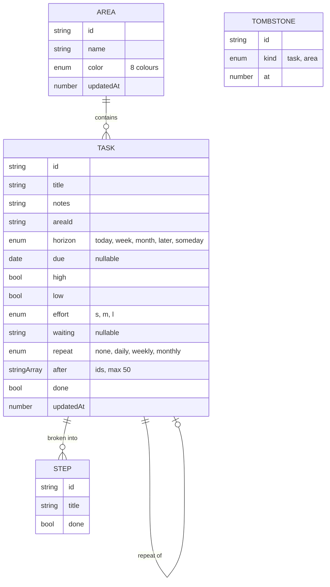

- **Effective horizon** is derived and never stored: it's the nearer of the chosen horizon and the
  horizon implied by the due date. Removing a date restores the person's own choice.
- **Priority** is two booleans (`high`, `low`), never both true, read through `priorityOf()`.
- **Tombstones** remember deletions so a sync merge can't bring an item back from another device.

---

## State, persistence and undo

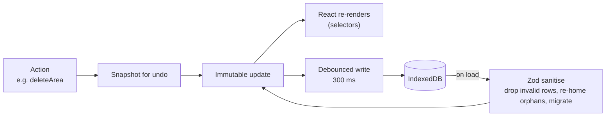

- Every destructive or bulk action takes a **single-level snapshot** and shows a 10-second Undo
  message. Undo only applies if that message is still the current one.
- Writes are debounced and flushed on `visibilitychange` and `pagehide`. Persistent storage is
  requested after the first task.
- On load, stored state is re-validated **row by row**. A bad task is dropped instead of wiping the
  list; tasks pointing at a missing area move to the first area. Old shapes are migrated: hidden
  areas from v1 are reset, and storage keys stay compatible across the rename.

---

## Routing

There's no router library. The current view is store state mirrored to `location.hash`, which makes
deep links, back and forward, and reload work on a static host.

| Hash | Screen |
| --- | --- |
| `#home` | Today |
| `#tasks`, `#tasks/map`, `#tasks/radar` | All tasks as list, map or radar |
| `#area/<id>[/map\|/radar]` | One area's tasks |
| `#focus` | Lock in |
| `#reset` | Weekly reset |

Malformed links (`#area/%E0%A4`) fall back to Today. A link to a deleted area falls back to All tasks.

---

## Capture and parsing

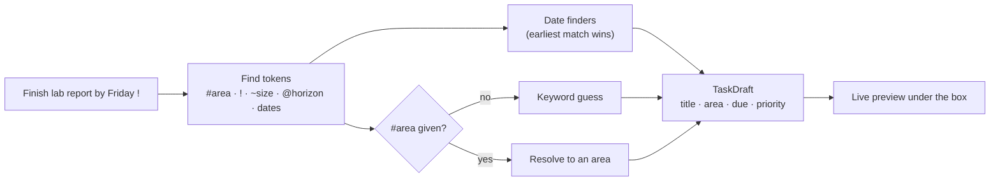

- **Dates** are local calendar days (`YYYY-MM-DD`). Arithmetic uses UTC day counts so daylight-saving
  changes never shift a date.
- Supported phrases: today, tomorrow, tonight, weekdays, this or next weekend, next week, eow, eod,
  month-day and numeric dates, "in N days or weeks".
- **Importers** (plain text, numbered lists, Markdown checklists with Obsidian Tasks emoji, JSON,
  Todoist CSV):
  - produce the same `TaskDraft`, reviewed in a preview before anything is added;
  - inputs are size- and line-capped, and parsers run in linear time.

---

## The planner

Ordering combines a numeric **urgency score** with a **topological sort**, so a task never appears
before the tasks it has to wait for.

```
urgency = max(deadline term, horizon term)
        + priority (high +, low −)
        + effort   (small +, big −)
        + waiting  (−)
        + momentum (+ when some steps are done)
```

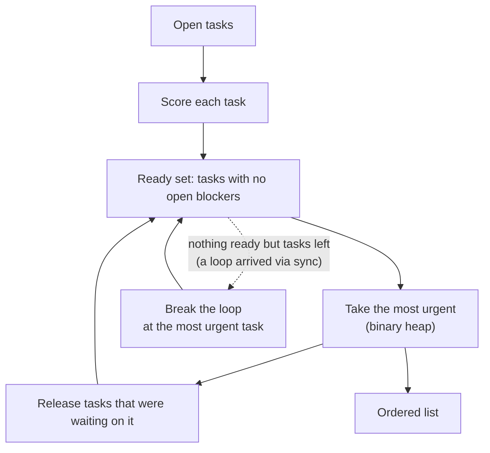

- **Complexity:** O((V + E) log V). Ordering 500 tasks with arbitrary dependencies takes about 10 ms.
- **No new loops:** every new link (user, Lock in or assistant) is checked with `wouldCreateCycle`, a
  reachability search over all tasks.

---

## Lock in

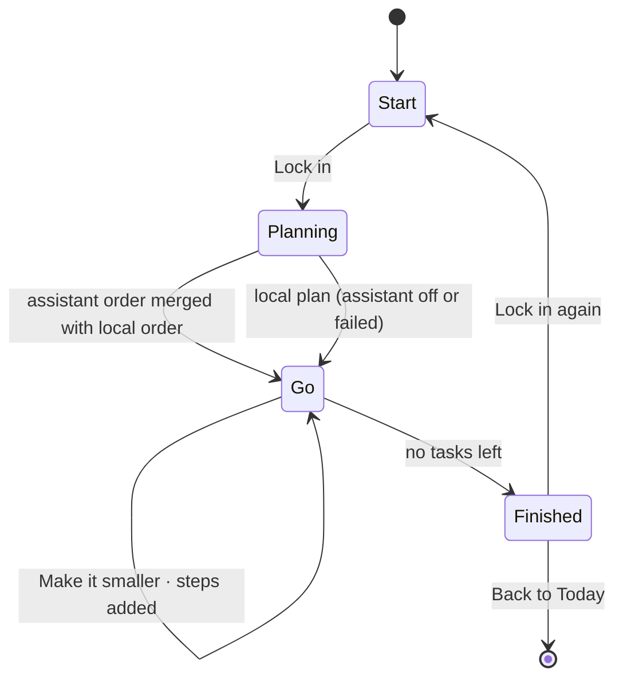

- **Local plan:** tasks that can start now (not blocked, not waiting on someone) come first, then the
  planner order. Each pick gets a plain reason ("It's due tomorrow.", "2 tasks wait on this one.").
- **Assistant plan:** Claude's order and reasons, restricted to tasks that still exist and are open,
  followed by anything it left out. Nothing is silently dropped.
- Locking in from a task's panel starts with that task.

---

## Reminders

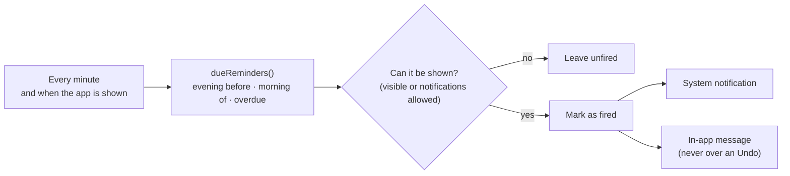

- More than three at once become one summary.
- Fired keys are pruned by task: a key goes away when its task is done, deleted or re-dated, so
  nothing fires twice and the list stays small.

---

## The assistant

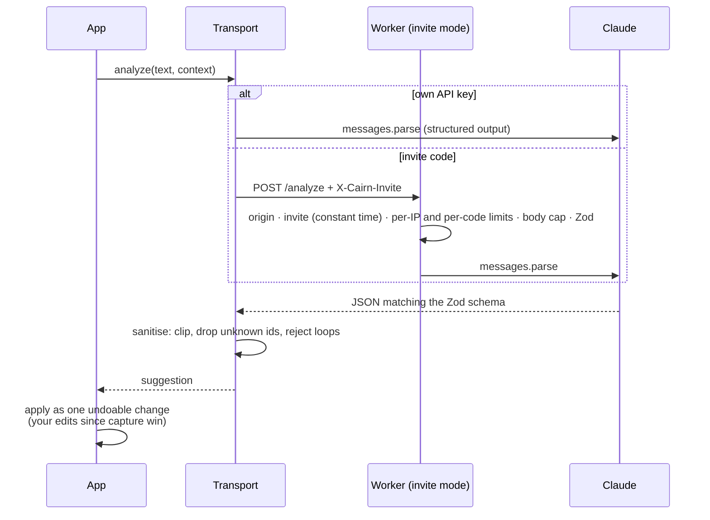

- **Model:** Claude Haiku 5.5 at low effort; about $0.001 per task. System prompts are stable and
  cached.
- **Context sent:** the new text plus, for up to 150 open tasks, title, area, due date and priority.
  Never notes, steps or the sync passphrase.
- **Lazy loading:** the SDK loads only when the assistant is first used (it would otherwise add about
  320 KB to the main bundle).

---

## Encrypted sync

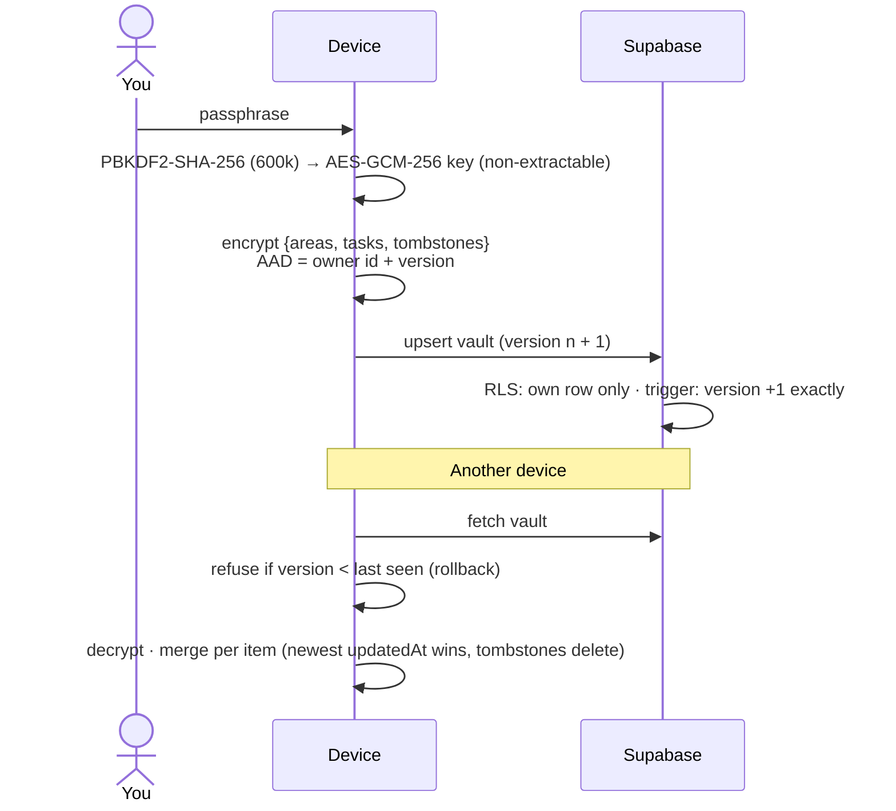

Details and the threat model: [SYNC.md](SYNC.md).

---

## Build, test and deploy

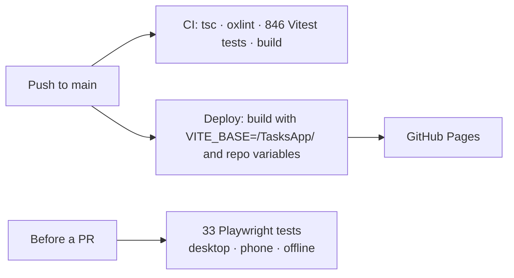

- The Vite build injects a **Content Security Policy** whose `connect-src` lists only the services
  that are configured, and **fails if a secret key** is found in the environment.
- vite-plugin-pwa precaches the app shell (28 entries) and updates in the background.

---

## Key decisions

| Decision | Why |
| --- | --- |
| Local-first, no account required | Useful in seconds; private by default; works offline |
| Zustand + one persisted document | The whole state is small; one schema and one migration path |
| Hand-rolled SVG for radar and map | Full control of layout, dragging and zoom without a graph library |
| Hand-written CSS with tokens | A bespoke design system; light and dark from the same roles |
| Hash routing | Static hosting with deep links and no 404 tricks |
| Zod at every boundary | Storage, imports, sync payloads, AI output and Worker requests are all untrusted |
| One Claude client for browser and Worker | Prompts, schemas and error handling can't drift apart |
| Haiku over Opus for the assistant | Short extraction and ordering jobs; about 40× cheaper |
| End-to-end encryption for sync | The server can't read tasks, which keeps the "private" promise |
| Deletions as tombstones | Merges across devices can't resurrect deleted items |
