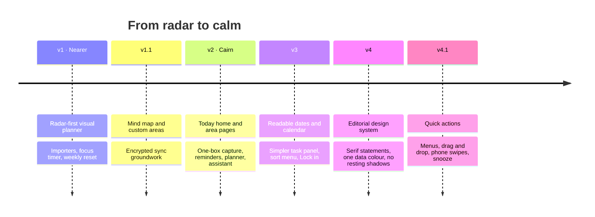

# Product and design

How Cairn decides what to show, why, and the design system that renders it.

- [Who it's for](#who-its-for)
- [Principles](#principles)
- [Research behind the design](#research-behind-the-design)
- [Screens and the question each one answers](#screens-and-the-question-each-one-answers)
- [Design system](#design-system)
- [Motion](#motion)
- [Accessibility](#accessibility)
- [Design history](#design-history)

---

## Who it's for

- **Primary:** a student juggling five to eight parts of life (classes, clubs, the job search,
  applications, side projects, self-study). They use a laptop during the day and a phone in between,
  and many have ADHD.
- **Also:** anyone with too many open loops who bounced off Notion, Todoist or a notes app.

What they share: they open a to-do app when they already feel behind. The app's job is to lower that
feeling, not to score it.

---

## Principles

| Principle | In practice |
| --- | --- |
| **Capture costs one keystroke** | One box, no form. The words carry the details; a quiet preview shows what was understood. |
| **One thing at a time** | Today leads with one Up next card; Lock in shows one step. Long lists live one click away. |
| **No guilt** | No red counters for normal life. Overdue appears in one place, in words, with a way out (snooze). Old tasks are faded, not flagged. |
| **Rare options appear when needed** | The task panel shows title, date, priority, steps and a note. Repeat, "waiting on" and "start after" appear only when used. |
| **Actions live where things are** | ⋯ menus and right-click on tasks and areas, drag to move, swipe on phones. Everything undoable. |
| **Private by default** | Works without an account or network. Sync and the assistant are opt-in and minimal. |
| **Calm, not bare** | Fewer elements, but each one is clear: real dates, real counts, a real next step. |

---

## Research behind the design

A desk review (Reddit communities such as r/productivity, r/ADHD and r/college, Hacker News, app
reviews, and the behavioural-science literature) found recurring reasons people abandon to-do apps.

**Why people stop using to-do apps**
1. **Guilt piles:** overdue counters turn the app into a scorecard
   ([IndieHackers](https://www.indiehackers.com/post/i-stopped-opening-todo-apps-because-of-the-guilt-so-i-built-one-with-no-overdue-label-at-all-gEmxidjhiObz4OgDfPs4),
   [Todoist on "bankruptcy"](https://todoist.com/inspiration/todo-list-bankruptcy)).
2. **Paralysis** from long visible lists.
3. **Setup as procrastination** in build-your-own systems.
4. **Out of sight, out of mind:** passive lists are forgotten.
5. **Nothing helps you start:** a list says *what*, never *when* or *how*.
6. **Childish gamification:** points and pets wear off.

**Mechanics with evidence, and where they live in Cairn**

| Finding | Source | In Cairn |
| --- | --- | --- |
| Implementation intentions ("I'll do X at time and place Y") improve goal attainment, d ≈ 0.65 | [NCI summary](https://cancercontrol.cancer.gov/brp/research/constructs/implementation-intentions) | Lock in turns a task into one concrete next step |
| People act on goals at temporal landmarks such as a new week (the fresh-start effect) | [Dai, Milkman & Riis, 2014](https://anderson-review.ucla.edu/wp-content/uploads/2021/03/Dai-Milkman-Riis_FreshStartEffect_2014_Mgmt_Sci.pdf) | The three-minute weekly reset |
| Students finish later than they predict (the planning fallacy) | [Buehler et al., 1994](https://bear.warrington.ufl.edu/brenner/mar7588/Papers/buehler-et-al-1994.pdf) | Readable dates, reminders the evening before, snooze instead of shame |
| Gamification effects are small and unstable (g ≈ 0.36) | Sailer & Homner, 2020 | One quiet reward (a stone on the cairn), no points |
| Breaking tasks into steps helps people start | Practice in ADHD tools such as Tiimo and goblin.tools | Steps in every task; *Make it smaller* |

**What popular no-sign-up tools share** (Excalidraw, tldraw, goblin.tools): useful in seconds, no
account, local saving, offline. Cairn saves to the device from the first keystroke.

---

## Screens and the question each one answers

| Screen | Its one question | The biggest thing on it |
| --- | --- | --- |
| Today | *What do I do next?* | The serif greeting with today's one finding, then Up next |
| All tasks | *What's on my plate, by area?* | The list, grouped by area |
| An area's page | *What's left in this part of my life, and when?* | The list, grouped by when |
| Task panel | *When is it due, and what's the first step?* | Title, then date and priority |
| Lock in | *What should I do right now?* | One step, set large in the serif face |

---

## Design system

The style is an "editorial greeting" app style:
- a tinted frame around a white sheet;
- stone panels with white cards inside;
- ink and near-black chrome;
- **one data colour**.

Everything is defined as CSS custom properties in `src/index.css`, with a dark theme that redefines
the same roles.

### Colour

| Role | Light | Dark | Used for |
| --- | --- | --- | --- |
| Frame (`--chrome`) | `#eef0ec` | `#0d0e0d` | Sidebar and the frame around the page |
| Sheet (`--canvas`) | `#ffffff` | `#151615` | The page itself |
| Panel (`--panel`) | `#f2f3ef` | `#1c1d1b` | Stone panels that group sections |
| Ink (`--ink`) | `#1f201d` | `#f2f3ef` | Text |
| Action (`--action`) | `#1f201d` | `#f2f3ef` | The one primary button per screen |
| Data teal (`--primary`) | `#1b6e66` | `#5cc8b6` | The cairn, this week's dates, selection, focus rings |
| Gold (`--sun`) | `#e9a930` | `#f2c160` | The top stone, "today and tomorrow" dates |
| Berry (`--danger`) | `#b42341` | `#ff8aa0` | Past-due only, and delete |

- **Areas** get one of 8 colours, used only as small dots and checkbox rings.
- **Contrast:** every text colour meets 4.5:1 on the surface it sits on.

### Type

- **Instrument Sans** (400, 500, 600) for everything; figures use tabular numerals.
- **Instrument Serif** for each screen's one statement only: Today's greeting and the Lock-in step.

| Role | Size |
| --- | --- |
| Statement (serif) | 48 px on Today, up to 56 px in Lock in |
| Page title | 26 px |
| Task title in Up next | 26 px |
| Counts | 32 px, regular weight |
| Body | 15 px |
| Labels and metadata | 12–13 px |

### Layout

- **Today** sits on a **12-column, 1100 px grid** (12 × 77 px + 11 × 16 px gutters = 1100 px). Rows
  share column lines: counts 3/3/3/3, then Up next 9 + cairn 3, then Today 6 + This week 6.
- **One gutter:** 16 px between blocks everywhere.
- **Radii** are soft and stepped: panels 22 px, row cards 14 px, controls fully rounded.
- **No shadows** on anything at rest. Separation comes from one tone step. Only things that float
  (menus, dialogs, the task sheet on narrow screens, messages) cast a shadow.
- **Phone:** a top bar and a bottom bar (Today · Tasks · + · Lock in · More); panels stack; the task
  panel becomes a bottom sheet.

---

## Motion

Motion is **feedback for something you did**, never decoration.

| Moment | Motion |
| --- | --- |
| Press a button | Squeezes to 96% with a spring |
| Tick a checkbox | The tick draws in with a small pop |
| Finish a task | The row slides out and collapses |
| Change screens | A 240 ms cross-fade with a 6 px rise |
| Change page in the sidebar | The highlight pill slides to the new item (shared layout animation) |
| Open the task panel | Springs in from the side (desktop) or the bottom (phone) |
| Finish something in Lock in | A stone drops onto the cairn |
| Swipe on a phone | The row follows your finger; past the threshold the action "arms" (colour and icon pop, light vibration) |

- Only `transform` and `opacity` are animated.
- With **reduced motion** turned on, the content stays and the movement is dropped.

---

## Accessibility

- **Structure:**
  - one `h1` per screen;
  - labelled regions and landmarks;
  - native `<dialog>` for modals;
  - real buttons and links throughout.
- **Keyboard:**
  - shortcuts for the main views;
  - menus with arrow keys, Escape and focus that returns to the button that opened them;
  - the keyboard menu key opens a task's actions;
  - a skip link.
- **Gestures have an equivalent control:** swipe ↔ checkbox and the ⋯ menu; drag ↔ *Move to area*.
- **Colour is never the only signal:** dates carry words, high priority carries a flag icon.
- **Touch targets** are at least 44 px on touch screens.
- **Live regions** announce status changes ("Sorting…", reminders, undo messages).

---

## Design history

Each round started from real use. The feedback that drove it, in short:
- **v1 → v2:** "overwhelming, too much text, unclear navigation."
- **v2 → v3:** "too many options and filters, hard to read the dates."
- **v3 → v4:** "lacks taste and smoothness."
- **v4 → v4.1:** "actions should be where the things are."

The v4 restyle was checked with an automated design inspector (headless Chrome at 1440, 768 and 390
px). It measured type, colour, contrast, layout and shadows, and went from four hard failures to none
on the three main screens.
